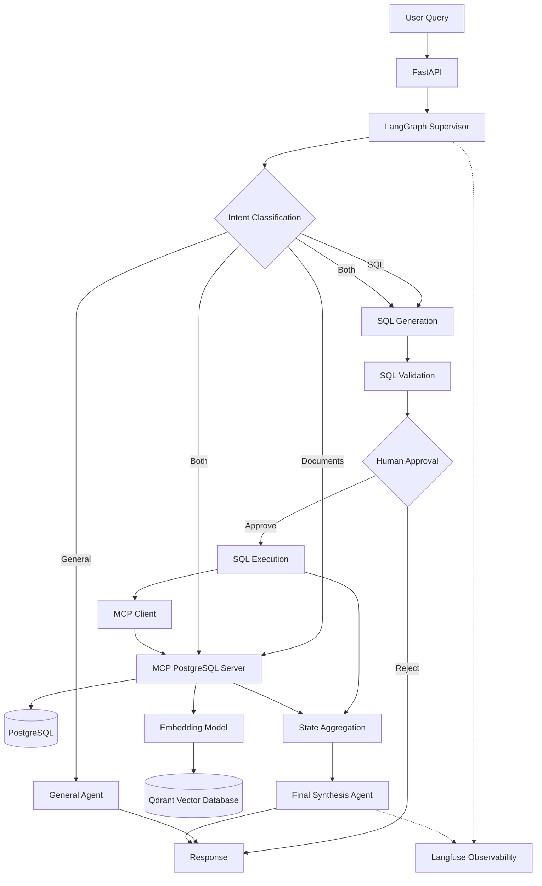

# DataNexus AI
### Enterprise Data Intelligence Multi-Agent Platform

**DataNexus AI** is an enterprise-oriented multi-agent platform built with **LangGraph, MCP, RAG, PostgreSQL, and Qdrant**. It enables users to interact with structured and unstructured enterprise data through natural language.

The platform intelligently routes questions to specialized agents, retrieves information from databases and business documents, and combines their results into grounded responses.

The goal is to build a scalable, reliable, and observable AI platform rather than a simple RAG chatbot.

---

## Key Features

- **Multi-Agent Orchestration:** Supervisor-based agent routing using LangGraph.
- **Natural Language to SQL:** Query structured PostgreSQL data using natural language.
- **Document Intelligence:** Retrieve and analyze business documents using RAG.
- **Hybrid Intelligence:** Combine SQL results and document evidence to answer complex questions.
- **MCP Integration:** Connect agents to database capabilities through Model Context Protocol.
- **Vector Search:** Use Qdrant for semantic document retrieval.
- **Observability:** Trace agent execution and LLM interactions using Langfuse.
- **RAG Evaluation:** Evaluate retrieval quality, faithfulness, and answer relevance using DeepEval.
- **Security:** Input validation, SQL restrictions, tool allowlisting, and PII masking.
- **Execution Reliability:** Timeouts, retries, fallback handling, and agent failure isolation.
- **Human-in-the-Loop:** Review generated SQL and approve or reject it before execution.

---

## Architecture



### Agent Responsibilities

| Agent | Responsibility |
|---|---|
| Supervisor | Classifies user intent and routes requests |
| SQL generation | Inspects schema and produces a query without database execution |
| SQL validation and approval | Rejects non-read-only SQL and pauses for human review |
| SQL execution | Runs only an approved query through the read-only MCP query tool |
| RAG Agent | Retrieves relevant documents and generates grounded answers |
| General Agent | Handles general conversational queries |
| Finalize Agent | Combines SQL and document results |

### Supported Query Types

**1. SQL Query**

Example:

> List the top 10 customers by revenue.

The SQL generation stage creates a query, then a separate execution stage sends it
to PostgreSQL through the read-only MCP tool.

**2. Document Query**

Example:

> What were the main reasons for the revenue decline?

The RAG agent retrieves relevant business documents from Qdrant and generates an evidence-based answer.

**3. Hybrid Query**

Example:

> Compare Q3 revenue performance with the reasons mentioned in business reports.

The supervisor routes the request to both SQL and RAG agents.

Both agents execute concurrently, update their respective state fields, and pass their results to the final synthesis agent.

---

## Technology Stack

| Component | Technology |
|---|---|
| Backend API | FastAPI |
| Agent Orchestration | LangGraph |
| LLM Integration | LangChain, OpenAI-compatible API |
| LLM Provider | OpenRouter |
| Database | PostgreSQL |
| Vector Database | Qdrant |
| Embeddings | FastEmbed |
| Agent Communication | Model Context Protocol (MCP) |
| Observability | Langfuse |
| Evaluation | DeepEval |
| Validation | Pydantic |
| Containerization | Docker, Docker Compose |
| Testing | Pytest |

---

## Project Structure

```text
datanexus-ai/
│
├── app/
│   ├── agents/
│   │   ├── sql_agent.py
│   │   └── rag_agent.py
│   │
│   ├── graph/
│   │   ├── state.py
│   │   ├── nodes.py
│   │   └── workflow.py
│   │
│   ├── rag/
│   │   └── store.py
│   │
│   ├── mcp_server/
│   │   └── server.py
│   │
│   ├── security/
│   │   ├── input_guard.py
│   │   ├── tool_guard.py
│   │   ├── sql_guard.py
│   │   └── pii_guard.py
│   │
│   ├── core/
│   │   ├── config.py
│   │   └── retry.py
│   │
│   ├── schemas/
│   │   └── chat.py
│   │
│   └── main.py
│
├── sql/
│   ├── init.sql
│   └── create_reader.sh
│
├── evals/
│   └── results/
│
├── tests/
│
├── docker-compose.yml
├── Dockerfile
├── pyproject.toml
├── .env.example
├── .gitignore
└── README.md
```

*The structure above represents the main project modules; additional files may be present as development progresses.*

---

## Getting Started

### Prerequisites

- Python 3.11+
- Docker Desktop
- Docker Compose
- OpenRouter API key

### 1. Clone the repository

```bash
git clone https://github.com/ajtiwari1/datanexus-ai.git

cd datanexus-ai
```

### 2. Configure environment variables

Create a `.env` file:

```dotenv
# PostgreSQL
POSTGRES_DB=datanexus
POSTGRES_USER=datanexus_admin
POSTGRES_PASSWORD=change_me

POSTGRES_READER_USER=datanexus_reader
POSTGRES_READER_PASSWORD=change_me

# LLM Configuration
OPENAI_API_KEY=your_openrouter_api_key
OPENAI_BASE_URL=https://openrouter.ai/api/v1
OPENAI_MODEL=your_model_id

# MCP
MCP_URL=http://mcp:8001/mcp

# Qdrant
QDRANT_URL=http://qdrant:6333

# Execution Timeouts
SQL_AGENT_TIMEOUT=30
RAG_AGENT_TIMEOUT=30
WORKFLOW_TIMEOUT=60
LLM_TIMEOUT=20

# Langfuse
LANGFUSE_ENABLED=true
LANGFUSE_PUBLIC_KEY=your_public_key
LANGFUSE_SECRET_KEY=your_secret_key
LANGFUSE_BASE_URL=https://cloud.langfuse.com
```

Use strong local credentials and never commit `.env` or API keys to GitHub.

### 3. Start services

```bash
docker compose up --build -d
```

Check running containers:

```bash
docker compose ps
```

### 4. Check API health

```bash
curl http://localhost:8000/health
```

### 5. Open API documentation

```text
http://localhost:8000/docs
```

---

## API Usage

### Chat Endpoint

**POST** `/chat`

Example request:

```json
{
  "question": "Compare Q3 revenue performance with the reasons mentioned in business reports."
}
```

The supervisor determines whether the request requires SQL, document retrieval, or both.
For SQL requests, the response pauses with `status: "approval_required"` and
includes the proposed SQL, a `request_id`, and a one-time `approval_token`.
Submit that token to exactly one of the following endpoints:

```bash
curl -X POST http://localhost:8000/approvals/<request_id>/approve \
  -H 'Content-Type: application/json' \
  -d '{"approval_token":"<approval_token>"}'

curl -X POST http://localhost:8000/approvals/<request_id>/reject \
  -H 'Content-Type: application/json' \
  -d '{"approval_token":"<approval_token>"}'
```

Approval resumes the workflow and executes the validated read-only query;
rejection resumes it without executing SQL. `/chat/sql` uses the same approval
flow but forces SQL routing. Approval checkpoints currently use in-memory
storage, so pending requests are lost if the API process restarts. Configure
persistent PostgreSQL checkpointing before using this across restarts or
multiple API workers. The approval token is a bearer capability; keep it secret.

### Document Ingestion

**POST** `/documents/ingest`

Example request:

```json
{
  "title": "Q3 Business Report",
  "text": "The company experienced a decline in revenue due to lower sales..."
}
```

Documents are split into chunks, embedded, and stored in Qdrant for semantic retrieval.

---

## MCP Integration

DataNexus AI uses the Model Context Protocol to expose PostgreSQL database capabilities to the SQL agent.

The MCP server provides tools such as:

- `list_tables`
- `describe_table`
- `run_readonly_query`

The SQL generation stage discovers schema tools dynamically and filters them through
an explicit allowlist. It does not receive the query execution tool; a separate
execution stage invokes `run_readonly_query` after generation. The MCP server
validates each query before execution.

Database access uses a dedicated read-only account. Application-level SQL validation provides an additional security layer.

---

## RAG Pipeline

The document retrieval pipeline consists of:

1. Document ingestion.
2. Text chunking.
3. Embedding generation.
4. Vector storage in Qdrant.
5. Semantic retrieval.
6. Context construction.
7. LLM-based grounded answer generation.

Retrieved documents are treated as untrusted reference data and cannot override system instructions.

---

## Reliability and Security

The platform incorporates several defensive mechanisms:

| Area | Implementation |
|---|---|
| Input validation | Pydantic validation |
| Tool security | MCP tool allowlisting |
| SQL security | Read-only SQL validation and database permissions |
| PII protection | Pattern-based PII masking |
| Timeout management | Async execution timeouts |
| Retry handling | Exponential backoff |
| Fallback handling | Partial-result fallback |
| Failure isolation | Independent SQL and RAG error handling |
| State aggregation | LangGraph reducers |

These application-level controls complement infrastructure security and database permissions.

---

## Evaluation and Observability

### DeepEval

The RAG evaluation pipeline uses metrics including:

- Faithfulness
- Answer Relevancy
- Contextual Precision
- Contextual Recall
- Contextual Relevancy

Evaluation reports are stored under `evals/results/`.

### Langfuse

Langfuse is used to inspect:

- LLM calls
- Agent execution traces
- Latency
- Token usage
- Workflow execution behavior

The objective is to make agent behavior observable and support systematic evaluation.

---

## Development Roadmap

| Phase | Description | Status |
|---|---|---|
| Phase 1 | Backend, PostgreSQL, MCP infrastructure | Completed |
| Phase 2 | LangGraph supervisor and multi-agent orchestration | Completed |
| Phase 2B | Qdrant-based RAG integration | Implemented |
| Phase 3 | Observability and evaluation foundation | Completed |
| Phase 4 | Baseline and RAG evaluation improvements | Completed |
| Phase 5A | Input validation and security guardrails | Completed |
| Phase 5B | Agent execution reliability | Completed |
| Phase 5C | Human-in-the-Loop approval workflow | In Progress |

### Phase 5C Tasks

| Task | Description | Status |
|---|---|---|
| 5C.2 | Separate SQL generation from execution | Completed |
| 5C.3 | Add SQL validation and approval policy | Completed |
| 5C.4 | Add LangGraph interrupt and resume support | Completed |
| 5C.5 | Add a persistent PostgreSQL checkpointer | Planned |
| 5C.6 | Add FastAPI approval and rejection endpoints | Completed |
| 5C.7 | Add approval authorization, audit logging, and tests | Planned |

### Upcoming Enhancements

- MCP and A2A interoperability.
- Large-scale synthetic enterprise datasets.
- Advanced agent evaluation and performance benchmarking.

---

## Running Tests

Run the complete test suite:

```bash
pytest tests/ -v
```

Run a specific test module:

```bash
pytest tests/test_parallel_workflow.py -v
```

---

## Design Principles

DataNexus AI is designed around the following principles:

1. **Modularity:** Each agent has a well-defined responsibility.
2. **Grounded Responses:** Answers should be supported by retrieved data.
3. **Controlled Tool Access:** Agents can only use explicitly permitted tools.
4. **Fault Tolerance:** Individual agent failures should not unnecessarily fail the entire workflow.
5. **Observability:** Agent execution should be traceable and measurable.
6. **Scalability:** The architecture should support additional agents, tools, and data sources.

---

## Author

**Ajay Tiwari**

- GitHub: [@ajtiwari1](https://github.com/ajtiwari1)
- Portfolio: [ajtiwari1.github.io](https://ajtiwari1.github.io)

---

## License

This project is intended as an engineering and learning project. Add a suitable open-source license before distributing it publicly.